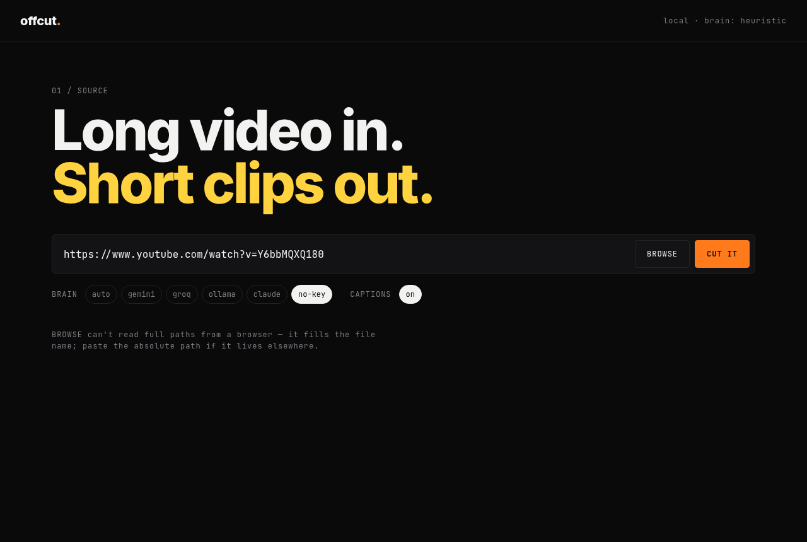
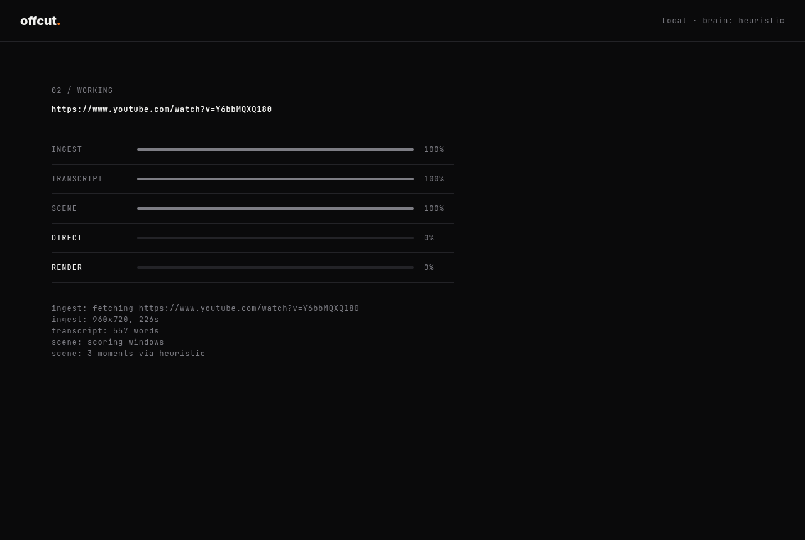
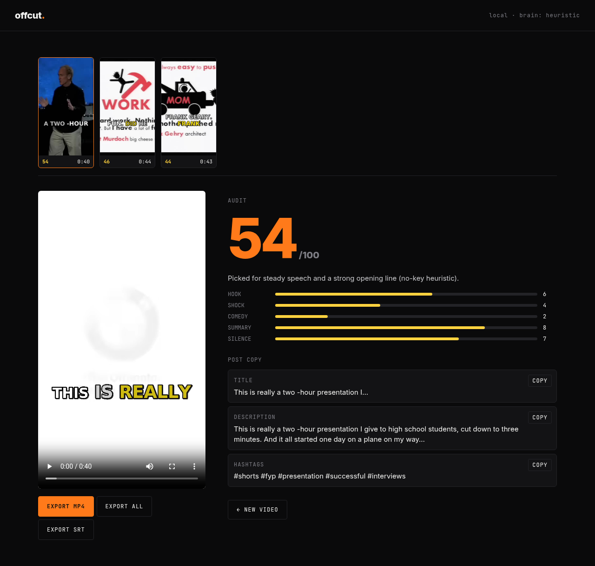

# offcut

Turn a long video into short vertical clips, on your own machine.

Paste a YouTube link or a local file. offcut transcribes it, picks the strongest
30–60s moments, reframes them to 9:16 around the speaker's face, and burns in
bold word-by-word captions (white, with emphasis words in yellow). Every clip
gets an **Audit** score and post copy you can paste straight into TikTok / Reels / Shorts.





## Run it

Needs Python 3.10+ and `ffmpeg` on your PATH.

```bash
./run.sh
```

First run creates `.venv` and installs everything, then opens http://localhost:7878.
The first transcription downloads the Whisper `base` model (~140 MB).

Headless, from the terminal:

```bash
./run.sh "https://www.youtube.com/watch?v=Y6bbMQXQ180" --count 4
./run.sh ~/Videos/podcast.mp4 --model gemini --no-captions
```

Output lands in `out/<job-id>/`: `clip_01.mp4`, `clip_01.srt`, a thumbnail and `job.json` with scores and copy.

## The brain

Picking moments is the only step that benefits from an LLM. offcut uses the first one it finds:

| env var             | brain   | default model (override)                          |
|---------------------|---------|---------------------------------------------------|
| `ANTHROPIC_API_KEY` | claude  | claude-sonnet-4-5 (`OFFCUT_CLAUDE_MODEL`)         |
| `GEMINI_API_KEY`    | gemini  | gemini-2.5-flash (`OFFCUT_GEMINI_MODEL`)          |
| `GROQ_API_KEY`      | groq    | llama-3.3-70b-versatile (`OFFCUT_GROQ_MODEL`)     |
| ollama on :11434    | ollama  | llama3.1 (`OFFCUT_OLLAMA_MODEL`)                  |
| nothing             | no-key  | built-in heuristic                                |

You can also force one with the chips in the UI. If an LLM call fails, offcut
falls back to the heuristic instead of dying. The heuristic scores 45s windows on
speech density, dead air, emphasis words and how the window opens. It's decent, but it isn't taste.

Whisper size: `OFFCUT_WHISPER=small ./run.sh` (default `base`, CPU int8).

## How it works

```
INGEST      yt-dlp → source.mp4, ffprobe for size/duration
TRANSCRIPT  faster-whisper, word timestamps, VAD
SCENE       brain picks windows + sub-scores + copy
DIRECT      OpenCV Haar face detection every 0.5s, smoothed with a dead-zone → crop path
RENDER      ffmpeg crop → 1080x1920, ASS captions with a scale pop on the active word
```

Progress is streamed to the browser over SSE (`/api/jobs/<id>/events`).

```
offcut/
  ingest.py      yt-dlp + ffprobe
  transcribe.py  faster-whisper
  brain.py       LLM providers + heuristic
  reframe.py     face track → ffmpeg crop expression
  captions.py    ASS + SRT
  pipeline.py    the job
  server.py      FastAPI + SSE
web/             plain HTML/CSS/JS, no build step
```

## Known rough edges

- The face crop uses Haar cascades. That's fast but dated: it misses profiles, and with two people on screen it follows whoever's face is biggest. When faces are found in fewer than 30% of samples, it uses a centre crop.
- The crop moves in steps, held for 0.5s at a time, instead of easing between positions.
- Sub-scores from the heuristic are rough. Comedy especially is mostly guesswork without an LLM.
- BROWSE fills in the file name only, because browsers hide real paths. Paste the absolute path for files outside the working directory.
- YouTube sometimes asks yt-dlp to prove it isn't a bot. offcut retries three times, but if YouTube keeps asking you'll need cookies (`yt-dlp --cookies-from-browser`). Having Node installed helps yt-dlp.
